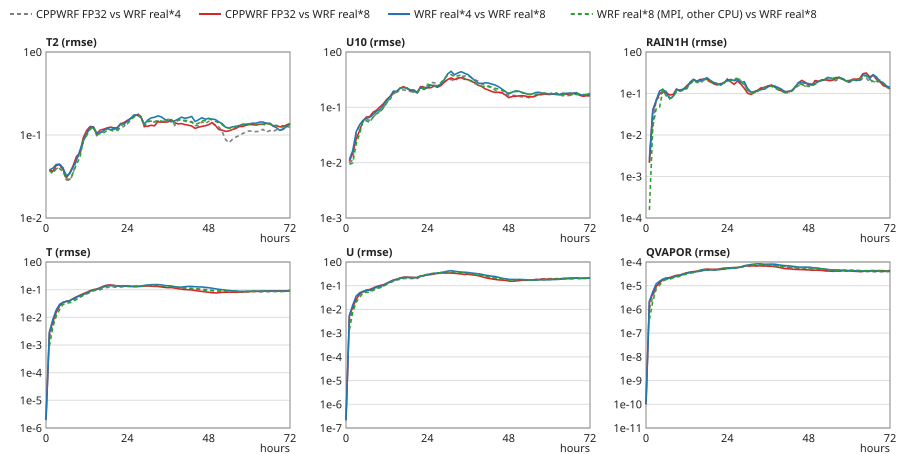
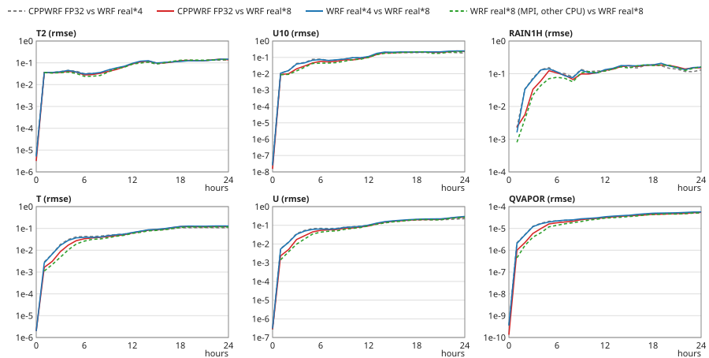
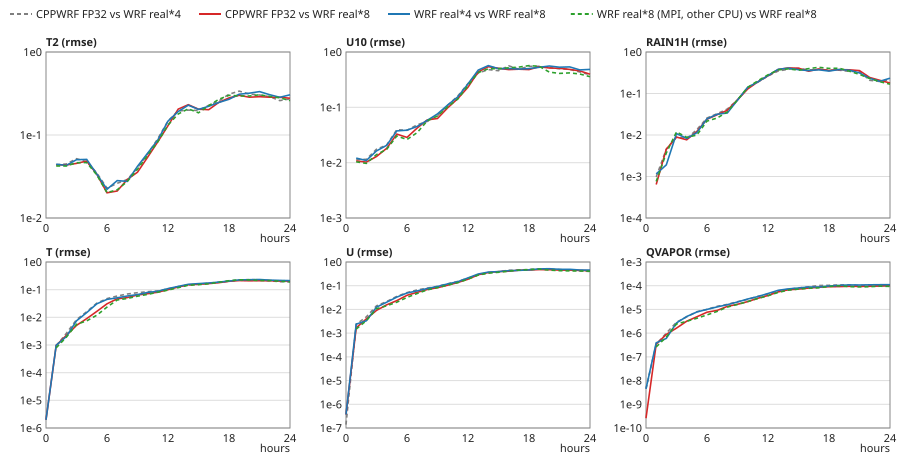

# CPPWRF GPU FP32 accuracy

CPPWRF's CPU FP64 and GPU FP64 builds are bit-identical to WRF v4.8.0 real*8. The GPU FP32 build, the fast mode on
GPUs with slow FP64 (RTX, L4, the RTX PRO 6000 Blackwell of a Colab G4), cannot be bit-identical to anything. The fair
question is whether it is as trustworthy as the WRF most people run, stock WRF real*4:

> Is the difference between CPPWRF GPU FP32 and WRF real*8 not larger than the difference between WRF real*4 and
> WRF real*8?

The measure is the ratio, per case, variable and output time,

    R = metric(CPPWRF GPU FP32 vs WRF real*8) / metric(WRF real*4 vs WRF real*8)

R <= 1: CPPWRF FP32 is at least as close to the double-precision answer as WRF's own single-precision build.

## Status

Measured (tools/bench/colab_fp32.sh, 2026-11-09/10): eleven domains at 1 h on a Colab L4, P4 for 72 h and N3 for
24 h on a Colab G4; see "Results" and "Verdict". An earlier, smaller measurement (docs/PERF.md's benchmark: relative
L2 of eight fields at 1 h, R 0.35 to 1.08) follows first.

## Earlier: the 1 h measurement of docs/PERF.md's benchmark

One Colab G4 runtime (AMD EPYC 9B45, RTX PRO 6000 Blackwell). WRF v4.8.0 real*4 and real*8 built from the release
source with WRF's configure for GNU (gfortran 14.2, MPICH), each run at its fastest MPI layout (24 ranks, or 24 x 2 /
12 x 4 ranks x threads); CPPWRF's CUDA FP32 release build; all from the same real*8 `wrfinput` / `wrfbdy`; the real*4
runs with WRF's single-precision RRTMG tables. Relative L2 difference ||a - b|| / ||b|| over the whole domain at 1 h.
Each cell: WRF real*4 vs WRF real*8 / CPPWRF FP32 vs WRF real*8 (R).

| Case | U | V | W | T | QVAPOR | PH | MU | PSFC |
|---|---|---|---|---|---|---|---|---|
| R1 (dynamics only) | 1.9e-04 / 8.7e-05 (0.46) | 1.5e-04 / 7.2e-05 (0.49) | 3.8e-03 / 3.7e-03 (0.98) | 3.8e-06 / 2.9e-06 (0.75) | 1.9e-05 / 7.7e-06 (0.41) | 1.3e-05 / 1.2e-05 (0.93) | 2.7e-05 / 2.5e-05 (0.93) | 2.0e-08 / 2.0e-08 (1.00) |
| P4 (KF, WSM6, YSU, Noah, RRTMG radt 1) | 6.5e-04 / 6.2e-04 (0.96) | 6.5e-04 / 6.3e-04 (0.97) | 1.7e-02 / 1.7e-02 (0.96) | 3.7e-05 / 3.5e-05 (0.96) | 5.5e-04 / 5.2e-04 (0.95) | 3.0e-05 / 2.9e-05 (0.98) | 1.8e-04 / 1.7e-04 (0.96) | 2.1e-06 / 1.9e-06 (0.94) |
| P4R15 (P4, radt 15) | 7.7e-04 / 4.6e-04 (0.59) | 7.6e-04 / 4.5e-04 (0.60) | 1.9e-02 / 1.2e-02 (0.60) | 4.9e-05 / 3.9e-05 (0.80) | 5.6e-04 / 4.2e-04 (0.76) | 3.3e-05 / 1.9e-05 (0.56) | 1.9e-04 / 7.8e-05 (0.41) | 2.0e-06 / 1.1e-06 (0.52) |
| N3 d01 (two-way nest, parent) | 6.6e-04 / 3.1e-04 (0.47) | 6.6e-04 / 3.2e-04 (0.48) | 1.7e-02 / 9.2e-03 (0.54) | 4.1e-05 / 2.7e-05 (0.65) | 5.4e-04 / 2.9e-04 (0.54) | 3.1e-05 / 1.4e-05 (0.45) | 1.9e-04 / 6.6e-05 (0.35) | 2.0e-06 / 9.6e-07 (0.47) |
| N3 d02 (5 km nest) | 3.6e-04 / 2.8e-04 (0.77) | 3.1e-04 / 2.2e-04 (0.70) | 5.9e-03 / 5.3e-03 (0.90) | 1.1e-05 / 1.2e-05 (**1.08**) | 9.5e-05 / 9.6e-05 (**1.01**) | 9.4e-06 / 9.8e-06 (**1.04**) | 3.2e-05 / 2.9e-05 (0.93) | 5.1e-07 / 4.6e-07 (0.90) |
| L (359 x 269 x 44, P4 physics, radt 15) | 2.9e-04 / 2.7e-04 (0.93) | 3.8e-04 / 4.0e-04 (**1.04**) | 1.1e-02 / 1.1e-02 (0.96) | 3.5e-05 / 3.4e-05 (0.97) | 2.5e-04 / 2.1e-04 (0.83) | 1.3e-05 / 1.3e-05 (0.98) | 4.5e-05 / 4.4e-05 (0.97) | 7.5e-07 / 7.0e-07 (0.93) |

What the numbers say, and what they do not:
- With physics, both differences are of the same size after one hour (R 0.9 to 1.0 in P4 and L): the physics'
  thresholds (convective triggers, saturation, the radiation every step) turn last-bit differences of any origin
  into differences of this size. Where they are smaller (R1 without physics, radiation every 15 minutes, N3's parent)
  CPPWRF FP32 is clearly closer to real*8 than WRF real*4.
- The largest R, 1.08 (T of the nest), is 8 %: within the spread of single-precision runs. WRF's own real*8 differs
  from itself by the same order of magnitude when its MPI layout changes (docs/PERF.md, "Agreement").
- The real*8 reference here is WRF real*8 at its fastest MPI layout on an AMD CPU, not the suite's one-process Intel
  reference; numerator and denominator use the same run. The full study uses CPPWRF GPU FP64 (= one-process WRF
  real*8) as the reference.
- One hour, eight 3-D / 2-D state fields. Rain, the surface fields and the growth over a day are the full study's.

## The full study

### Method

**Models.** One Colab runtime (tools/bench/colab_fp32.sh):
- WRF v4.8.0 from the official release source, WRF's own `configure` for GNU (dmpar, option 34) in the Debian 13
  chroot of the suite (gfortran 14.2, MPICH): real*4 (no `-r8`: the usual production build) and real*8
  (`configure -r8`). The real*4 runs read WRF's single-precision RRTMG tables and compute their own Thompson tables.
- CPPWRF's release builds of README.md: CUDA FP32 (`-DCPPWRF_DOUBLE=OFF`: CUDA's math library, FMA contraction) and
  CUDA FP64.
- The real*8 reference of every comparison is the CPPWRF GPU FP64 run. It is bit-identical to WRF real*8 run in one
  process on Intel (the suite's references); the same session re-runs the suite's tolerance-0 GPU FP64 cases of the
  studied configurations to show it. Using it rather than a new WRF real*8 run removes two effects that have nothing
  to do with precision: WRF's dependence on its MPI layout, and on the CPU's libmvec (an AMD CPU gives other last
  bits of `log` than the Intel CPUs that made the references).
- Every model runs the same namelist from the same real*8 `wrfinput` / `wrfbdy` files (WRF real*4 converts them on
  reading), history every 10 minutes (1 h runs) or every hour (long runs), restart off.

**Cases** (tools/bench/fp32_run.py, CASES):

| Case | Configuration | Length | WRF real*4 runs |
|---|---|---|---|
| P4 | 15 km, 119 x 89 x 44, KF + WSM6 + YSU + Noah + RRTMG (radt 1) | 1 h | one process; also 8 MPI ranks |
| P6 | P4 domain, Thompson | 1 h | one process |
| P9 | P4 domain, MYJ + Eta | 1 h | one process |
| N3 | P4 with a two-way nest (5 km, 120 x 90) | 1 h | one process; also 12 MPI ranks |
| V1 | tropics (Bay of Bengal) | 1 h | one process |
| T1 | Arctic | 1 h | one process |
| SKV | V1 with `sst_skin` = 1, `tmn_update` = 1 | 1 h | one process |
| MORR | P4 with Morrison (mp 10, hail) and KF | 1 h | one process |
| ACM7 | P4 with ACM2 over the Pleim-Xiu surface layer | 1 h | one process |
| L | 359 x 269 x 44 at 15 km (WPS and real.exe on the runtime from GFS), P4 physics, radt 15 | 1 h | one process |
| P4L | P4 from the real.exe inputs of the suite's 72 h reference | 72 h | 8 MPI ranks; first 24 h also in one process |
| N3L | N3 from the inputs of the suite's 24 h reference | 24 h | 12 MPI ranks |

The long real*4 runs use MPI ranks: one process would need about 2.5 h for each. WRF's result depends on its process
layout; P4 and N3 in both layouts for 1 h, and P4L's first 24 h in one process, show how much.

**Pairs** (columns of the tables):
- `r4-r8`: WRF real*4 (one process; long runs: MPI) against WRF real*8 (= CPPWRF FP64).
- `fp32-r8`: CPPWRF GPU FP32 against WRF real*8.
- `fp32-r4`: CPPWRF GPU FP32 against WRF real*4.
- `r4m-r8`, `r4s-r8`: WRF real*4 in the other layout (MPI for P4 and N3, one process for P4L).
- `r8n-r8` (long runs, on runtimes with 32 or more vCPUs): WRF real*8 with MPI ranks on the runtime's CPU against
  the one-process Intel answer, a perturbation of the last bits in double precision: how fast any perturbation grows.
- `fp64-ref`: CPPWRF GPU FP64 against the suite's WRF real*8 reference files (must be 0).

**Statistics** (tools/verify/fp32_accuracy.py, numpy and netCDF4 only, any two sets of wrfout files): per output
time and variable the max |d|, the RMSE, the relative L2 difference and the bias of T2, Q2, U10, V10, PSFC, TSK,
SWDOWN, HFX, LH, PBLH, the accumulated rain RAINNC + RAINC and the hourly rain, the 3-D T, QVAPOR, U, V, W, PH, the
hydrometeor mixing ratios and number concentrations; for rain the fraction of points whose category differs (hourly
rain >= 0.1, 1 and 5 mm, accumulated rain >= 1 and 10 mm). `report` turns the statistics of several pairs into the
tables (R per variable, the growth table at 1, 3, 6, 12, 24, 48, 72 h) and SVG figures of the growth (log scale).

```bash
tools/verify/fp32_accuracy.py compare FP32_RUN_DIR R8_RUN_DIR --domain d01 --case P4 --pair fp32-r8 --out p4.jsonl
tools/verify/fp32_accuracy.py compare WRF_R4_DIR R8_RUN_DIR --domain d01 --case P4 --pair r4-r8 --out p4.jsonl
tools/verify/fp32_accuracy.py report p4.jsonl --metric rmse --svg-dir docs/img --svg-rel img
```

### Running the study

```bash
# the 1 h cases (a G4; --gpu L4 or A100 if no G4 is free)
CPPWRF_GCP_BUCKET=<bucket> tools/bench/colab_fp32.sh --cases P4,P6,P9,N3,V1,T1,SKV,MORR,ACM7,L
# the long runs (24 h N3, 72 h P4), without the suite cases
CPPWRF_GCP_BUCKET=<bucket> tools/bench/colab_fp32.sh --cases P4L,N3L --no-suite --hours 8
```

Each session: the WRF builds (11 minutes on a G4, 29 on an L4), WPS for L, the WRF runs several at a time, the GPU
runs, the suite's tolerance-0 GPU FP64 cases of the studied configurations and the FP32 suite cases (staged with
tools/colab/stage_data.py, as a GPU proof stages them), then the statistics, all on the runtime. Only the
statistics, the three reports (`report_rmse.md`, `report_max_abs.md`, `report_rel_l2.md`) and the SVG figures come
back (3 MB). Measured: the 1 h part 70 minutes on an L4 (2.3 compute units; the one-process real*4 runs of L, N3,
V1 and SKV take 25 minutes there), the long part 2.5 h on a G4 (about 25 units; P4L's 24 h in one process sets the
length). Without a G4 the long part needs 5 to 6 h on a 12-vCPU runtime.

### Results: 1 h

Run 2026-11-09 on a Colab L4 runtime (Intel Xeon 2.2 GHz, 12 vCPUs; NVIDIA L4, sm_89; no G4 was free), CPPWRF
54f3c0e + driver commits (no model change since b0c4309). WRF real*4 in one process for every case.

**FP64 equals WRF real*8.** The suite's tolerance-0 GPU FP64 cases of the studied configurations (P4, P6, P9, V1 2 h,
T1, N3, SKV, MORR, ACM7) passed on the same runtime (`SUITE PASS 9 FAIL 0`, every variable of every frame), and the
`fp64-ref` pair (the study's own FP64 runs against the suite's references) is 0 in all 1221 records (every variable
and frame of the 1 h runs). The FP64 runs are therefore WRF real*8.

**R per case and variable** (RMSE over the domain at 1 h; bold: R > 1.1):

| Case | T2 | Q2 | U10 | PSFC | HFX | PBLH | RAIN1H | T | QVAPOR | U | W | QCLOUD | QRAIN | QSNOW |
|---|---|---|---|---|---|---|---|---|---|---|---|---|---|---|
| P4 | 1.07 | 1.00 | 0.94 | 0.97 | 1.01 | **2.57** | 0.82 | 1.06 | 0.99 | 0.98 | 1.00 | 1.05 | 0.87 | 0.83 |
| P6 | 0.51 | 0.62 | 0.39 | 0.92 | 0.45 | 0.37 | 0.23 | **1.13** | 1.05 | 0.87 | 1.10 | 0.65 | 0.95 | 0.73 |
| P9 | 0.52 | **1.11** | 1.00 | 0.86 | 0.59 | **1.14** | - | 0.99 | **1.13** | 0.99 | 0.97 | - | - | - |
| N3 d01 | 1.02 | 1.06 | 0.81 | 0.47 | 1.05 | 0.81 | 0.91 | 0.61 | 0.41 | 0.43 | 0.52 | 0.92 | 1.03 | 1.02 |
| N3 d02 | 0.98 | 1.00 | 0.88 | 0.83 | 1.04 | 1.00 | 0.74 | 0.99 | 1.08 | 0.72 | 0.87 | 0.64 | 0.70 | 0.98 |
| V1 | **1.10** | 1.02 | 0.96 | 0.85 | **1.10** | 1.02 | **1.17** | 1.05 | **1.11** | 1.04 | 1.02 | **1.63** | **1.14** | **2.27** |
| T1 | - | 1.00 | - | 1.00 | - | - | - | 0.83 | **1.64** | 0.51 | 0.98 | - | - | - |
| SKV | 1.08 | **1.15** | **1.28** | **1.14** | **1.16** | **1.49** | 1.09 | **1.12** | 0.93 | **1.21** | **1.23** | 1.07 | 1.03 | **1.52** |
| MORR | 0.99 | 0.98 | 1.06 | 0.66 | 0.97 | 0.89 | **1.17** | **1.24** | 1.05 | 1.01 | 0.91 | **1.59** | **2.33** | **1.68** |
| ACM7 | 1.01 | 0.92 | 0.86 | **1.26** | 0.97 | **1.23** | 0.83 | **1.99** | **2.32** | **1.57** | **1.23** | **2.14** | **1.38** | **1.87** |
| L | 1.00 | 1.02 | 0.98 | 0.85 | 0.98 | 1.09 | 0.72 | 0.94 | 0.93 | 0.91 | 0.83 | 1.04 | 0.83 | 1.02 |

Layout spread of WRF real*4 (rmse(r4 MPI vs r8) / rmse(r4 one process vs r8)):

| Case | T2 | Q2 | U10 | PSFC | HFX | PBLH | RAIN1H | T | QVAPOR | U | W | QCLOUD | QRAIN | QSNOW |
|---|---|---|---|---|---|---|---|---|---|---|---|---|---|---|
| P4 d01 | 1.05 | 1.00 | 0.97 | 1.02 | 0.97 | **1.64** | 1.02 | **1.11** | 1.05 | 1.04 | 1.03 | **1.43** | 0.98 | **1.28** |
| N3 d01 | 1.02 | 1.07 | 0.95 | 1.01 | 1.00 | **1.83** | 0.99 | 1.01 | 1.01 | 1.01 | 1.02 | 0.71 | 0.89 | 0.84 |
| N3 d02 | 1.00 | 1.09 | 0.95 | 1.01 | 0.95 | **1.11** | 1.01 | 0.98 | 1.03 | 1.03 | 0.99 | 1.00 | **1.35** | 1.09 |

Hourly rain >= 1 mm, fraction of points whose category differs (r4-r8 / fp32-r8; wet fraction):

| Case | r4-r8 | fp32-r8 | wet |
|---|---|---|---|
| P4 | 0.0e+00 | 0.0e+00 | 0.005 |
| P6 | 0.0e+00 | 0.0e+00 | 0.000 |
| P9 | 0.0e+00 | 0.0e+00 | 0.000 |
| N3 d01 | 0.0e+00 | 0.0e+00 | 0.005 |
| N3 d02 | 0.0e+00 | 0.0e+00 | 0.000 |
| V1 | 3.8e-04 | 5.7e-04 | 0.029 |
| T1 | 0.0e+00 | 0.0e+00 | 0.000 |
| SKV | 2.8e-04 | 3.8e-04 | 0.029 |
| MORR | 0.0e+00 | 0.0e+00 | 0.005 |
| ACM7 | 0.0e+00 | 0.0e+00 | 0.005 |
| L | 5.2e-05 | 4.1e-05 | 0.002 |

How to read it:
- **The claim holds in 7 of the 11 domains** (P4, P6, P9, N3 d01 and d02, T1, L): median R 0.80 to 1.01, every
  near-surface field within 1.1 except single threshold-driven fields (P4 PBLH 2.57, T1 QVAPOR 1.64; see below).
  In P6 (Thompson) and N3's parent CPPWRF FP32 is clearly closer to real*8 than WRF real*4 (R 0.4 to 0.6 in many
  fields).
- **A single real*4 run is a noisy reference.** The same WRF real*4 executable with 4 MPI ranks instead of one
  process changes the RMSE against real*8 by up to 1.83x (PBLH), 1.43x (QCLOUD) and 1.1x (T) at 1 h (second table).
  R between about 0.7 and 1.4 for the 3-D state, and up to about 2 for PBLH and the hydrometeors, is within the
  spread of WRF real*4 itself. P4's PBLH (2.57) and the scattered hydrometeor values of V1 and SKV are of this kind:
  PBLH is a level index times a layer depth, so a few columns whose PBL top moves one level dominate its RMSE.
- **Real excesses** beyond that spread:
  - **ACM7** (ACM2 PBL over the Pleim-Xiu surface layer): T 1.99, QVAPOR 2.32, U 1.57, V 1.72, QCLOUD 2.14, the
    other hydrometeors 1.4 to 2.7, while the surface fields stay at 0.86 to 1.26. CPPWRF FP32 is as far from WRF
    real*4 as from real*8 (fp32-r4 ~ fp32-r8), so its single-precision arithmetic in this configuration perturbs the
    state about twice as much as WRF real*4's in the first hour.
  - **MORR** (Morrison): the hydrometeors (QRAIN 2.33, QGRAUP 7.9, QNRAIN 2.95, QNGRAUPEL 42) and T 1.24; the
    absolute values are tiny (QGRAUP RMSE 2e-9 kg/kg, QNGRAUPEL 0.47 per kg) and the dynamics and surface fields are
    at 0.66 to 1.06: a few points of graupel / hail that FP32 creates or removes where WRF real*4 does not.
  - **SKV** (skin SST): median 1.16, the near-surface and 3-D fields 1.1 to 1.5. V1 without the skin SST is at
    1.0 to 1.1 for the same fields, so the skin SST scheme's FP32 path adds a little.
  - Likely causes (not verified): CUDA FP32 contracts multiply-adds (FMA) and uses CUDA's libm, while gfortran's
    real*4 code has neither; schemes with iterations and thresholds (ACM2's PBL height and mixing, Pleim-Xiu's
    stability iteration, Morrison's graupel / hail thresholds, the warm layer and cool skin) amplify such last-bit
    differences. Candidate check and fixes (result-changing for FP32 only, so for a later release): run the CPU FP32
    build of CPPWRF (no FMA, glibc's libm) on ACM7 / MORR / SKV against WRF real*4 to separate arithmetic from code
    differences; then `--fmad=false` or double-precision accumulators in ACM2 / Pleim-Xiu / Morrison's FP32 kernels.
- **Rain categories:** hourly rain >= 1 mm changes category at 0 to 6e-4 of the points; CPPWRF FP32 and WRF real*4
  are within a factor 1.5 of each other (third table).
- At 1 h every difference is small in absolute terms (T2 RMSE 0.01 to 0.04 K, U10 0.01 m/s, PSFC 0.05 to 0.2 Pa).

### Results: 24 h and 72 h

Run 2026-11-10 on a Colab G4 (AMD EPYC 9B45, 48 vCPUs; RTX PRO 6000 Blackwell, sm_120), the same commit. P4L:
WRF real*4 with 8 MPI ranks for 72 h and in one process for 24 h; N3L: WRF real*4 with 12 ranks for 24 h; `r8n`:
WRF real*8 with 8 / 12 ranks on this AMD CPU, i.e. the real*8 answer with its last bits perturbed (MPI layout,
another libmvec log). History every hour.

**R stays at 0.8 to 1.1 throughout** (RMSE ratios fp32-r8 / r4-r8, report summary):

| Case | Domain | 1 h median R (largest) | end of run median R (largest) |
|---|---|---|---|
| P4L | d01 | 0.95 (QRAIN 1.13, Q2 1.13) | 72 h: 1.03 (QSNOW 1.30, QRAIN 1.18, QCLOUD 1.14) |
| N3L | d01 | 0.83 (QICE 1.78, QGRAUP 1.49) | 24 h: 0.94 (QCLOUD 1.02) |
| N3L | d02 | 0.94 (QCLOUD 1.11) | 24 h: 0.90 (QCLOUD 1.11) |

**Chaotic growth makes all perturbations equal.** Within 6 to 12 hours every difference, whatever its origin,
reaches the same size: WRF real*4 (either layout), CPPWRF FP32 and even WRF real*8 with only its last bits perturbed
(`r8n`) are equally far from the real*8 answer. RMSE at 24 h / 72 h:

P4L d01 at 24 h, RMSE (r4-r8 / r4s-r8 / r8n-r8 / fp32-r8):

| T2 | U10 | PSFC | RAIN | T | QVAPOR | U | W |
|---|---|---|---|---|---|---|---|
| 0.147 / 0.138 / 0.136 / 0.15 | 0.227 / 0.224 / 0.26 / 0.225 | 5.2 / 4.72 / 5.3 / 5.02 | 0.788 / 0.774 / 0.734 / 0.762 | 0.135 / 0.122 / 0.139 / 0.133 | 5.25e-05 / 5.66e-05 / 5.64e-05 / 5.6e-05 | 0.291 / 0.273 / 0.302 / 0.282 | 0.025 / 0.0259 / 0.0258 / 0.0265 |

P4L d01 at 72 h, RMSE (r4-r8 / r4s-r8 / r8n-r8 / fp32-r8):

| T2 | U10 | PSFC | RAIN | T | QVAPOR | U | W |
|---|---|---|---|---|---|---|---|
| 0.136 / - / 0.136 / 0.138 | 0.178 / - / 0.179 / 0.168 | 3.66 / - / 3.98 / 3.87 | 2.01 / - / 1.92 / 2 | 0.0916 / - / 0.0925 / 0.0945 | 4.08e-05 / - / 4.23e-05 / 4.34e-05 | 0.207 / - / 0.211 / 0.215 | 0.0161 / - / 0.0158 / 0.016 |

N3L d01 at 24 h, RMSE (r4-r8 / r8n-r8 / fp32-r8):

| T2 | U10 | PSFC | RAIN | T | QVAPOR | U | W |
|---|---|---|---|---|---|---|---|
| 0.148 / 0.139 / 0.138 | 0.248 / 0.221 / 0.234 | 4.97 / 4.31 / 4.56 | 0.686 / 0.627 / 0.672 | 0.129 / 0.116 / 0.122 | 5.67e-05 / 5.13e-05 / 5.43e-05 | 0.297 / 0.269 / 0.271 | 0.0263 / 0.0258 / 0.0227 |

N3L d02 at 24 h, RMSE (r4-r8 / r8n-r8 / fp32-r8):

| T2 | U10 | PSFC | RAIN | T | QVAPOR | U | W |
|---|---|---|---|---|---|---|---|
| 0.305 / 0.26 / 0.277 | 0.485 / 0.357 / 0.397 | 6.89 / 5.38 / 5.26 | 1.27 / 1.33 / 1.32 | 0.213 / 0.191 / 0.205 | 0.00011 / 9.32e-05 / 0.000102 | 0.457 / 0.409 / 0.431 | 0.0454 / 0.0423 / 0.0423 |

Hourly rain >= 1 mm changes category at 0.7 to 1.9 % of the points at 24 h (with 2 to 3 % of the points rainy) and
24 h rain >= 10 mm at 1 to 3 %, alike for all pairs (P4L 72 h: r4-r8 1.33 %, fp32-r8 1.30 %, r8n-r8 1.42 %).







(Blue: WRF real*4; red: CPPWRF FP32; grey dashed: CPPWRF FP32 against WRF real*4; green dashed: WRF real*8 with
perturbed last bits.)

## Verdict

- **FP64 is WRF real*8** at tolerance 0 in all studied configurations (suite cuda_dp cases and 1221 compared
  variable-frames).
- **GPU FP32 is as trustworthy as stock WRF real*4** for forecasts: after a few hours its difference from real*8 is
  the chaotic spread that any last-bit perturbation reaches, even one in double precision (24 h / 72 h R 0.8 to
  1.1; WRF real*4's own process layout moves the same numbers by up to 10 %).
- **In the first hours** FP32 is as close to real*8 as WRF real*4 or closer for KF / WSM6 / YSU / Noah / RRTMG, Thompson,
  MYJ, the nest, the Arctic, the tropics and the large domain. It is further than WRF real*4 (R 1.2 to 2.3 in the
  3-D state and hydrometeors at 1 h) with ACM2 + Pleim-Xiu (ACM7), in Morrison's graupel / hail, and slightly
  (R ~1.2) with the skin SST. Whether this persists beyond a few hours in those configurations was not measured
  (the long runs use the P4 physics). Candidate causes and checks are listed under "Results: 1 h".

## When to use FP32 and when FP64

- FP64 (CPU or GPU) when the answer must be WRF's: verification against WRF real*8, studies that compare against
  WRF runs, restarts that must continue a WRF run exactly.
- GPU FP32 for production forecasts and ensembles on GPUs with slow FP64: on a G4 it steps 1.7 to 4.3 times faster
  than GPU FP64 (docs/PERF.md). Beyond the first hours its distance from WRF real*8 is that of WRF real*4, the build
  most WRF users run. For studies of the first hours with ACM2 / Pleim-Xiu, Morrison or the skin SST, prefer FP64
  (or compare with it): there FP32 starts up to twice as far from real*8 as WRF real*4.
